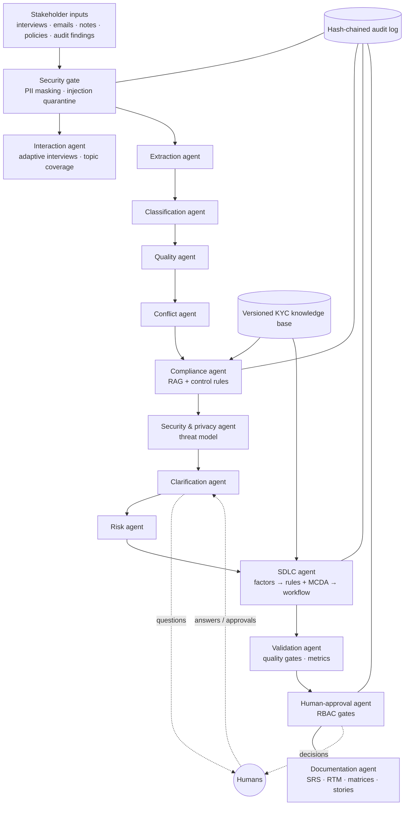

# KYC Agentic Requirement Engineering

An agentic AI system for **automated requirement gathering, analysis and SDLC
recommendation** in financial services, built around **customer onboarding and KYC**,
one of the sectors in the problem statement (`Problem Statement(1).docx`).

Specialised agents interview stakeholders and read conversations and documents. They
mask sensitive data, extract and classify requirements, detect ambiguity and conflicts,
map requirements to KYC/AML regulations and mandatory controls, derive missing security
and compliance requirements, build a risk register, and recommend a ranked,
justified SDLC with a project-specific workflow. The output is an SRS (.docx), user
stories, use cases, a compliance-control matrix and a traceability matrix. Every
critical decision goes through a human-approval gate, and every action lands in a
hash-chained audit trail.

> Why KYC, and the design principles: see [`docs/APPROACH.md`](docs/APPROACH.md).
> Evaluation results: see [`docs/evaluation/RESULTS.md`](docs/evaluation/RESULTS.md).
> Example output: see [`docs/sample_output/`](docs/sample_output/) (including `SRS.docx`).

## Quick start

```bash
python -m venv .venv && . .venv/bin/activate
pip install -e ".[llm,dev]"

# Full pipeline on the NeoBank case study -> artefacts in ./output
kyc-re --llm offline run samples/kyc_onboarding -o output

# Metrics vs gold annotations
kyc-re --llm offline evaluate samples/kyc_onboarding

# Pre-analyse the samples so the web UI opens them instantly as demo projects
# (already done for the committed samples; re-run after changing agents or samples)
kyc-re build-demos

# Web UI + REST API at http://127.0.0.1:8000
# (drag-and-drop .txt/.md/.eml/.docx files; for PDFs: pip install -e ".[docs]")
kyc-re serve

# Adaptive interview in the terminal
kyc-re interview --role compliance --name "Arjun"

pytest -q
```

### Local LLM mode (recommended for sensitive data)

Run a model on your own machine so that no stakeholder or customer text leaves it.

```bash
# Arch: sudo pacman -S ollama-cuda && sudo systemctl enable --now ollama
# Other OSes: https://ollama.com/download
ollama pull qwen2.5:7b-instruct          # ~4.7 GB, fits a 6 GB GPU
kyc-re --llm ollama run samples/kyc_onboarding -o output
```

| Variable | Default | Purpose |
|---|---|---|
| `KYC_RE_LLM` | `auto` | `ollama`, `openai_compat`, `claude`, `offline`, or `auto` |
| `KYC_RE_LOCAL_MODEL` | `qwen2.5:7b-instruct` | Model name on the local server |
| `OLLAMA_HOST` | `http://localhost:11434` | Ollama endpoint |
| `KYC_RE_LOCAL_URL` | `http://localhost:8080/v1` | OpenAI-compatible endpoint (llama.cpp `llama-server`, LM Studio, vLLM) |
| `KYC_RE_LOCAL_TIMEOUT` | `600` | Seconds per call |

`auto` tries a reachable local server first, then Claude if credentials are set, and
otherwise falls back to offline rules. Local output is constrained to a JSON schema
(Ollama `format` / `response_format`), checked structurally, and passed through the
same grounding guards as Claude. Any failure falls back to the rule baseline for that step.

### Cloud LLM mode (Claude)

The system runs fully **offline** with deterministic rule-based agents, which is how the
tests and the reported evaluation run. With Anthropic credentials (`ANTHROPIC_API_KEY`
set, or `--llm claude`), the agents use Claude (`claude-opus-5-5` by default, override
with `KYC_RE_MODEL`) for extraction, classification, clarification questions, interview
follow-ups, compliance obligations and the SDLC narrative.

Claude outputs are **fenced**:

* Inputs are PII-masked and wrapped in `<untrusted_document>` tags, never placed in the system prompt.
* Output is constrained to a JSON schema (structured outputs). A refusal falls back server-side (`fallbacks: "default"`), and any error falls back to the rule baseline.
* Every extracted requirement must quote a verbatim source excerpt; ungrounded items are dropped and counted as hallucinations.
* Compliance citations must be KB ids that the retriever actually returned; anything else is dropped and counted.
* SDLC scores always come from the deterministic engine. The LLM only writes the explanation.
* Each call's model, purpose, prompt hash, outcome and token usage go to the audit log.

## How it maps to the problem statement

| § | Problem-statement item | Implementation |
|---|---|---|
| 1 | Scope & outputs | KYC/onboarding domain. Outputs: SRS, stories, use cases, acceptance criteria, compliance matrix, risk register, RTM, SDLC (`kyc_re/artefacts/writers.py`) |
| 2 | Stakeholders & role templates | 12 roles; role-specific topic focus in `knowledge/data/interview.json` |
| 3 | Inputs + sensitive-data protection | 12 source types; PII classification and masking before any agent sees text (`security/pii.py`, `agents/ingestion.py`); raw text discarded after masking |
| 4 | Multi-agent architecture | 13 agents + coordinator (`kyc_re/agents/*`, `coordinator.py`); deterministic orchestration, shared `ProjectState`, approval gates |
| 5 | Financial knowledge base | Versioned JSON KB: FATF, RBI KYC MD / V-CIP / re-KYC / CKYCR, PMLA, DPDP, EU AMLD/AMLR, GDPR, US CIP/CDD/OFAC/BSA, NIST 800-63, ISO 30107-3, OWASP ASVS, ISO 27001, internal policies, 22 mandatory controls, SDLC profiles, glossary. Each item has source, jurisdiction, effective date, version and applicability |
| 6 | Retrieval-grounded generation | BM25 retriever with jurisdiction and effective-date filtering (`knowledge/kb.py`), citations with scores, confidence scoring, low-confidence → legal-review gate |
| 7 | Adaptive interviews | `agents/interaction.py`: picks topics by role, follows up on vague/short answers (LLM or rules), skips covered topics; web and CLI front-ends |
| 8 | Standard requirement structure | `models.Requirement`: ID, statement, categories, source stakeholder, evidence, justification, priority, dependencies, assumptions, acceptance criteria, regulations, risk, confidence, approval status, history |
| 9 | Multi-label classification | 13 categories, multi-label, plus a primary label used for the ID prefix (`agents/classification.py`) |
| 10 | Quality analysis | Ambiguity, incompleteness, untestability, infeasibility, undefined terms, missing source, non-atomic, missing security controls (`agents/quality.py`); duplicates and contradictions (`agents/conflict.py`); failures go to clarification |
| 11 | Compliance & security analysis | Control mapping with citations, jurisdiction, gaps, regulatory-minimum checks (e.g. retention < 5 years, re-KYC interval), legal-review flags, no final legal determinations (`agents/compliance.py`); STRIDE-lite threat model (`agents/security_privacy.py`) |
| 12 | Artefacts linked to source | SRS.docx, RTM.csv (statement → source doc/excerpt → regulation → control → story → use case → tests → risks), compliance matrix, risk register, assumptions/dependencies/open issues |
| 13 | SDLC decision factors | 14 factors with evidence-based rationales (`sdlc/engine.py`) |
| 14 | SDLC selection engine | Hard rules + weighted MCDA over 7 model profiles (Waterfall, V-Model, Spiral, Agile, DevSecOps, Agile–V hybrid, Agile–DevSecOps hybrid) → ranked % scores; approval needs PM, architect, security and compliance together |
| 15 | Project-specific workflow | Phases with activities, roles, deliverables, security activities, testing, compliance checkpoints, approval gate, entry/exit criteria, traceability (`sdlc/workflow.py`) |
| 16 | Human-in-the-loop | Mandatory gates (baseline, regulatory interpretation, high-risk security, conflicts, architecture, SDLC, changes to approved requirements); approve / reject / modify / regenerate; baseline blocked until quality gates pass (`agents/approval.py`) |
| 17 | Platform security | RBAC per gate; least-privilege agent scopes (`security/rbac.py`); PII masking; injection screening and quarantine (`security/injection.py`); allowlisted retrieval sources (KB only); hash-chained audit log (`audit.py`); KB and model versioning in every artefact. MFA and encryption at rest are delegated to the deployment (IdP / storage); see *Production notes* |
| 18 | Prototype | Python package + CLI + FastAPI + web UI; SQLite-free JSON persistence for the demo |
| 19 | Evaluation | `kyc-re evaluate`: extraction P/R/F1, classification accuracy, ambiguity and conflict P/R, control-mapping P/R, gap detection, coverage, citation validity, hallucination rate, SDLC agreement, traceability, time (`evaluation/evaluate.py`); 3 annotated cases |
| 20 | Deploy, monitor, improve | Advisory-mode default (nothing is approved automatically); audit of prompts, evidence, decisions and changes; versioned KB for regulatory updates |

## Architecture



The **coordinator** (`kyc_re/coordinator.py`) runs this graph in a fixed order, times
each stage, and re-runs the analysis stages after every human answer, modification or
change request.

## Results at a glance (offline rule mode)

| Case | Extraction F1 | Conflict P/R | Control-mapping F1 | Gap-detection F1 | Citation validity | SDLC acceptable |
|---|---|---|---|---|---|---|
| NeoBank (IN), dev set | 0.98 | 0.75 / 1.0 | 0.83 | 1.0 | 100% | ✔ Agile–DevSecOps hybrid |
| PayFlow (EU), after fixes | 0.98 | 0.50 / 1.0 | 0.89 | 0.86 | 100% | ✔ Agile–V hybrid |
| Summit (US), held-out | 1.00 | 0.0 / 0.0 | 0.70 | 0.90 | 100% | ✘ Spiral |

The held-out Summit case is the most honest number. Rules catch explicit needs and
explicit contradictions, but miss implicit semantic conflicts, which is the gap the
Claude mode targets. Gold labels were written by the project team, not an independent
expert panel. Full details and caveats: [`docs/evaluation/RESULTS.md`](docs/evaluation/RESULTS.md).

## REST API

| Method | Path | Purpose |
|---|---|---|
| GET | `/api/health`, `/api/kb`, `/api/agents`, `/api/samples` | System info, KB manifest and control catalogue |
| POST | `/api/projects` · `/api/projects/from-sample/{case}` | Create a project / load and analyse a sample from scratch |
| GET, POST | `/api/demos` · `/api/demos/{case}?reset=` | List / open a pre-analysed demo project instantly (no agents run) |
| POST | `/api/split-speakers` | Preview who said what in a pasted text (nothing stored) |
| POST | `/api/projects/{id}/conversation` | Add a pasted text as one input per person, with role corrections, and analyse |
| GET | `/api/progress` · `/api/projects/{id}/progress` | Live progress of a run: current agent, what each step found, model calls |
| POST | `/api/projects/{id}/documents` · `/run` | Add input (masked on arrival) / run agents |
| POST | `/api/projects/{id}/documents/batch` | Add several inputs and analyse once (`run: false` to defer) |
| POST | `/api/extract-text` | Extract text from an uploaded `.docx` / `.pdf` / text file for review (nothing stored) |
| POST | `/api/projects/{id}/interviews` · `/{sid}/answer` · `/{sid}/finish` | Adaptive interview |
| POST | `/api/projects/{id}/questions/{qid}/answer` | Answer a clarification (triggers re-analysis) |
| POST | `/api/projects/{id}/approvals/{aid}` | Decide a gate (`X-User`, `X-Role` headers; RBAC enforced) |
| POST | `/api/projects/{id}/requirements/{rid}/change` | Change request (adds a change gate if already approved) |
| GET | `/api/projects/{id}` · `/audit` · `/export` | Full state / audit chain / artefact zip |

## Project layout

```
kyc_re/
  agents/          13 agents (ingestion, interaction, extraction, classification, quality,
                   clarification, conflict, compliance, security_privacy, risk, sdlc,
                   validation, approval, documentation)
  knowledge/       KB loader + BM25 retriever; data/*.json (regulations, standards,
                   policies, controls, interview topics, SDLC profiles, glossary)
  sdlc/            decision factors, rules + MCDA scoring, workflow templates
  security/        PII masking, injection screening, RBAC & agent scopes
  artefacts/       SRS.docx / CSV / Markdown / JSON writers
  evaluation/      gold-based evaluation harness
  api/             FastAPI app + single-page web UI
  coordinator.py   orchestrator and human-in-the-loop operations
  llm.py           Claude client (schema-constrained, audited) and offline fallback
  audit.py         hash-chained audit log
samples/           3 annotated case studies (IN / EU / US)
docs/              approach, evaluation results, sample output
tests/             unit, pipeline, API and LLM-guard tests
```

## Production notes and limitations

* **Regulatory content is paraphrased** for prototyping. Validate every KB item against
  official texts and assign owners for regulatory-change monitoring.
* **Authentication** in the API is a header-based demo. Put it behind the bank's IdP
  (OIDC + MFA) and take roles from verified claims. Store state in an encrypted
  database (the `ProjectState` model maps directly to relational tables), and keep the
  audit log in WORM storage.
* **Name detection** in the PII masker is out of scope (regex-based). Add an NER model for
  person names and addresses before using real customer data.
* **Rule-mode limits:** implicit or semantic conflicts and unusual phrasing of controls
  are missed or over-flagged (see the evaluation). LLM mode and a larger annotated corpus
  are the next steps.
* The SDLC factor weights are expert heuristics. Calibrate them against historical
  architect decisions.
